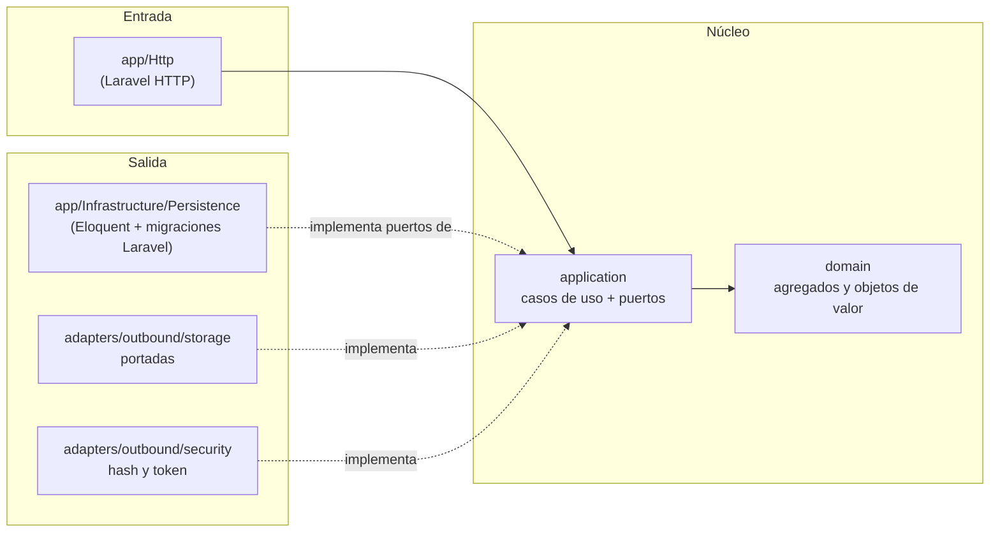
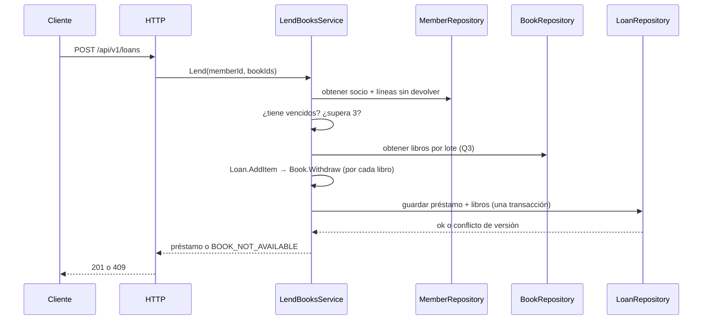

# Arquitectura — Manager Library (PHP/Laravel)

Arquitectura **hexagonal** (puertos y adaptadores). Las reglas de dependencia son los artículos I a III de [`constitution.md`](constitution.md).

## 1. Capas y dependencias



Las flechas de dependencia apuntan **hacia adentro**. `bootstrap` es el único que ve las dos mitades. Los controladores HTTP traducen rutas y transporte a casos de uso; no contienen reglas de negocio. Los adaptadores Eloquent traducen explícitamente entre el esquema `library` y los modelos de dominio.

## 2. Estructura de carpetas

```text
app/
├── Domain/              # Book, Loan, LoanItem, Member, User; Isbn, Quantity, DateRange
├── Application/
│   ├── Ports/Outbound/  # BookRepository, LoanRepository, MemberRepository, UserRepository,
│   │                    # ReportReader, Clock, PasswordHasher, TokenIssuer, CoverStorage
│   └── Services/        # LendBooksService, ReturnItemService, CreateBookService, SearchBooksService,
│                        # OverdueService, MostBorrowedReportService, LoginService, CreateLibrarianService
├── Http/                # controladores, requests, resources y manejo de errores
├── Infrastructure/      # Persistence/, Storage/, Security/
└── Bootstrap/Composition/ServiceBindings.php — único punto de composición
```

## 3. Agregados

| Raíz | Contiene | Invariantes que defiende |
|---|---|---|
| `Book` | `Isbn`, copias totales y disponibles, testigo de versión, baja lógica | disponibles entre 0 y total; total ≥ 1; versión ≥ 1; título no vacío |
| `Loan` | colección de `LoanItem` | 1 a 3 líneas; sin libro repetido; vencimiento a 14 días; inmutable salvo devolución |
| `Member` | documento | documento obligatorio y único |
| `User` | rol, hash | nombre normalizado; rol en (`admin`, `librarian`) |

`LendBooksService` coordina la lectura/revalidación del socio, sus líneas abiertas, la creación de líneas congeladas y el descuento de todos los libros dentro de una única transacción de aplicación. La versión del libro evita prestar el último ejemplar dos veces, pero no basta para defender el límite concurrente de tres líneas por socio; la estrategia para ese límite está pendiente (DT-011) y bloquea la implementación completa de HU-06.
`ReturnItemService` coordina condicionalmente `returned_at` (solo si aún es nulo) y `Book.Restock` dentro de una única transacción. Si dos devoluciones compiten, una sola puede reintegrar existencias; la otra recibe el conflicto de HU-07.

La gestión de socios (HU-05) usa `MemberRepository` para crear y buscar por nombre o documento y no ofrece borrado. La consulta/listado de préstamos (HU-08) usa `LoanRepository` para obtener líneas, filtrar por rango, estado calculado y socio, ordenar por fecha descendente y paginar. No se introduce un caso de uso o tabla adicional.

### Adaptación Eloquent al esquema existente

El modelo físico prevalece en nombres y relaciones: las tablas son singulares bajo el esquema PostgreSQL `library`; las claves primarias son UUID generados por la aplicación; no hay `created_at`/`updated_at`, `status` ni `days_late`. La configuración Eloquent debe declarar explícitamente tabla, clave primaria/tipo UUID, conexión/esquema y marcas de tiempo deshabilitadas. La baja lógica usa `deleted_at` solo para `Book`; no usar `SoftDeletes` en `Loan` ni `LoanItem`. Los contratos/atributos del dominio no heredan convenciones de pluralización, timestamps ni cascadas del ORM. La forma exacta de mapear UUID, esquema, borrado lógico y relaciones queda como verificación de persistencia DT-007.

## 4. Flujo: registrar un préstamo



En una devolución, la transacción condiciona la actualización de la línea a `returned_at IS NULL` y actualiza el libro como parte de la misma operación. Para HU-08, el estado se deriva de las líneas y del reloj actual en consulta; no se persiste.

## 5. Errores

El dominio y la aplicación lanzan errores propios (`BookNotAvailable`, `MemberHasOverdue`, `MemberLimitExceeded`, …). **Solo** el adaptador HTTP los
traduce al cuerpo único y al código de estado de [`api-contract.md`](api-contract.md). Un error de framework nunca llega al cliente.

## 6. Qué no hay

Sin eventos, sin colas, sin caché, sin microservicios, sin multi-tenencia. Se añaden si un requisito lo pide, no antes.
