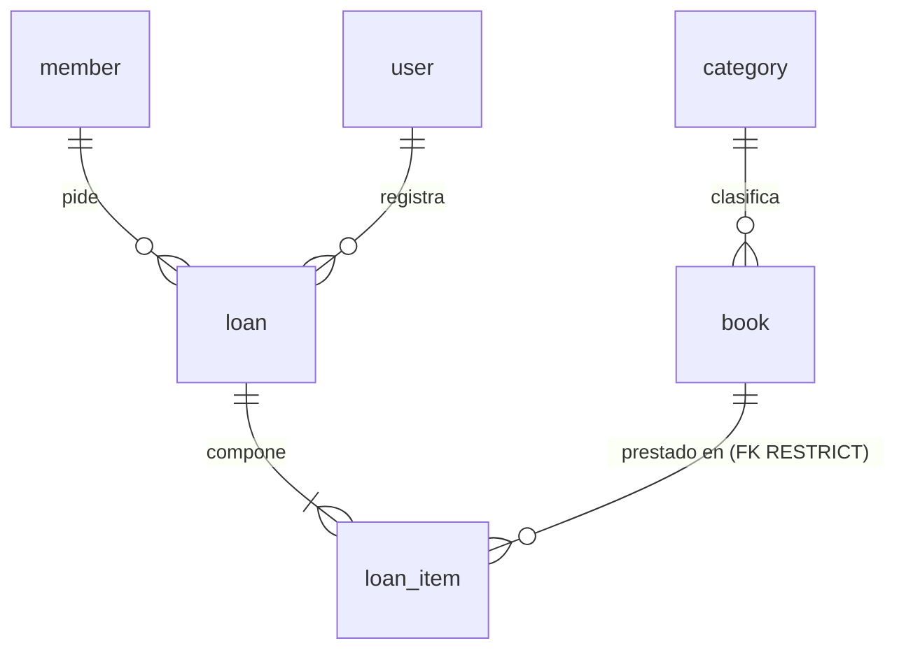

# Modelo de datos — Manager Library

**El único sitio donde vive el modelo de datos.** Quien implemente no necesita abrir el código ni conectarse
al motor para saber qué hay, de qué tipo y con qué regla.

- Motor de referencia: PostgreSQL 16. Esquema `library`. Servidor en UTC.
- Rige bajo [`constitution.md`](constitution.md) y [`spec.md`](spec.md). Este documento define el esquema esperado; no puede cambiar unilateralmente requisitos funcionales aprobados. Si una decisión funcional contradice el modelo, se registra y corrige la documentación antes de implementar; si la base desplegada contradice el modelo documentado, la migración/despliegue es el defecto y debe alinearse con este documento.

Cada regla lleva una de **tres marcas**: **motor** (la impone la base), **solo dominio** (solo el código),
**pendiente (T-xx)** (la pone esa tarea de [`tasks.md`](tasks.md)).

---

## 0. Convención de nombres

| Elemento | Convención | Ejemplo |
|---|---|---|
| Tabla | `snake_case`, inglés, **singular** | `loan_item` |
| Columna | `snake_case`, inglés, singular, ASCII | `due_at` |
| Restricción escrita a mano | `ck_{tabla}_{regla}` | `ck_book_available_range` |
| Esquema | `library` | `library.loan` |

`user` se escribe `library."user"` en SQL a mano; el ORM lo entrecomilla solo.

## 1. Glosario

| Término | Definición | Dónde vive |
|---|---|---|
| **Libro** | Título del catálogo, con autor, ISBN, categoría, ejemplares y portada opcional | `book` |
| **Categoría** | Clasificación fija de cinco, sembrada, sin mantenimiento | `category` |
| **Ejemplar** | Copia física de un libro. Se cuenta, no se identifica | `book.total_copies`, `book.available_copies` |
| **Socio** | Persona que pide prestado. No inicia sesión | `member` |
| **Préstamo** | Hecho consumado: quién lo pidió, quién lo registró y cuándo | `loan` |
| **Línea de préstamo** | Un libro dentro de un préstamo, con su vencimiento y su devolución | `loan_item` |
| **Estado del préstamo** | `open`, `overdue` o `closed`. **Se calcula, no se almacena** | sin columna |
| **Usuario** | Operador interno con rol `admin` o `librarian` | `user` |
| **Congelado** | Copia del valor en el instante del préstamo; no sigue al catálogo | `loan_item.book_title`, `isbn`, `category_name` |

## 2. Entidades y relaciones



Seis entidades, seis tablas. No hay tabla de reporte, de multas ni de auditoría.

## 3. Modelo físico

Ninguna columna lleva `DEFAULT`: los valores los pone el dominio.

**`category`** — semilla de solo lectura.

| Columna | Tipo | Nulable | Nota |
|---|---|---|---|
| `id` | `uuid` | no | PK. Identificadores literales (ver §9) |
| `name` | `varchar(120)` | no | Único |

**`book`**

| Columna | Tipo | Nulable | Nota |
|---|---|---|---|
| `id` | `uuid` | no | PK |
| `title` | `varchar(250)` | no | Recortado por el dominio |
| `author` | `varchar(200)` | no | |
| `isbn` | `char(13)` | no | Solo dígitos. Único entre libros activos (índice parcial) |
| `category_id` | `uuid` | no | FK restrictiva a `category` |
| `total_copies` | `integer` | no | ≥ 1 |
| `available_copies` | `integer` | no | Entre 0 y `total_copies` |
| `version` | `integer` | no | Testigo de concurrencia optimista; inicia en 1 y aumenta en cada mutación persistida; sin `DEFAULT` |
| `cover_key` | `varchar(512)` | **sí** | Clave opaca; nunca ruta ni bytes; nunca cadena vacía |
| `deleted_at` | `timestamptz` | sí | Baja lógica. Nula = activo |

**`member`**

| Columna | Tipo | Nulable | Nota |
|---|---|---|---|
| `id` | `uuid` | no | PK |
| `full_name` | `varchar(200)` | no | |
| `document_number` | `varchar(30)` | no | Único |

**`loan`**

| Columna | Tipo | Nulable | Nota |
|---|---|---|---|
| `id` | `uuid` | no | PK |
| `member_id` | `uuid` | no | FK restrictiva a `member` |
| `loaned_by_user_id` | `uuid` | no | FK restrictiva a `user` |
| `loaned_at` | `timestamptz` | no | Instante del préstamo |

**`loan_item`**

| Columna | Tipo | Nulable | Nota |
|---|---|---|---|
| `id` | `uuid` | no | PK |
| `loan_id` | `uuid` | no | FK con `ON DELETE CASCADE` |
| `book_id` | `uuid` | no | FK restrictiva a `book` |
| `book_title` | `varchar(250)` | no | Congelado; mismo ancho que `book.title` |
| `isbn` | `char(13)` | no | Congelado |
| `category_name` | `varchar(120)` | no | Congelado; **sin FK a propósito** |
| `due_at` | `timestamptz` | no | `loaned_at` + 14 días, calculado por el dominio |
| `returned_at` | `timestamptz` | **sí** | Nula mientras no se devuelve |

**`user`**

| Columna | Tipo | Nulable | Nota |
|---|---|---|---|
| `id` | `uuid` | no | PK |
| `username` | `varchar(120)` | no | Único, minúsculas, recortado |
| `password_hash` | `varchar(512)` | no | Nunca se indexa |
| `role` | `varchar(40)` | no | `admin` o `librarian` |

Reglas transversales: **todas las marcas de tiempo son `timestamptz`**; **no hay columnas de auditoría** (`created_at`/`updated_at`)
porque ningún requisito las pide.

## 4. Restricciones e índices: dónde vive cada regla

| Regla | Objeto | Marca |
|---|---|---|
| Claves primarias de las seis tablas | `PK_*` | **motor** |
| `category.name` único | índice único | **motor** |
| `member.document_number` único | índice único | **motor** |
| `user.username` único | índice único | **motor** |
| `isbn` único entre activos | índice único parcial `WHERE deleted_at IS NULL` | **motor** |
| `book.category_id` → `category.id` RESTRICT | FK | **motor** |
| `loan.member_id` → `member.id` RESTRICT | FK | **motor** |
| `loan.loaned_by_user_id` → `user.id` RESTRICT | FK | **motor** |
| `loan_item.loan_id` → `loan.id` CASCADE | FK | **motor**, con riesgo documentado en §5 y DT-006 |
| `loan_item.book_id` → `book.id` RESTRICT | FK | **motor** |
| `0 <= available_copies <= total_copies` | `ck_book_available_range` | **motor** — última barrera de concurrencia |
| `version >= 1` | `ck_book_version_positive` | **motor** |
| `total_copies >= 1` | `ck_book_total_positive` | **pendiente (T-18)** · hoy solo dominio |
| Único `(loan_id, book_id)` | índice único | **motor** |
| `role` en (`admin`,`librarian`) | `ck_user_role` | **pendiente (T-18)** · hoy solo dominio |
| Máximo 3 sin devolver por socio | — | **solo dominio** (no expresable en un `CHECK`) |
| Socio con vencidos no pide | — | **solo dominio** |
| Descontar ejemplar y crear línea son una operación | — | **solo dominio** (una transacción) |
| Un préstamo tiene 1 a 3 líneas | — | **solo dominio** |
| Préstamos y devoluciones inmutables salvo `returned_at` | — | **solo dominio** (por ausencia de operación) |

Índices de acceso: `book (category_id, title)` parcial sobre activos; `loan (loaned_at)`; `loan_item (book_id)`;
`loan_item (due_at) WHERE returned_at IS NULL` para vencidos.

La operación de préstamo y devolución actualiza `book` de forma condicional con `id` y `version` esperada dentro de la misma transacción.
Si no se modifica ninguna fila, el adaptador traduce el conflicto a `BOOK_NOT_AVAILABLE` (409). Una actualización exitosa incrementa
`version` exactamente una vez.

## 5. Política de claves foráneas

| # | FK | `ON DELETE` | Por qué |
|---|---|---|---|
| FK-1 | `book.category_id` | RESTRICT | Una categoría con libros no se elimina |
| FK-2 | `loan_item.loan_id` | CASCADE | Composición: la línea no vive sin su préstamo. Aunque no existe una operación aprobada para borrar préstamos, una eliminación directa del padre sí borraría el historial en cascada; ver el riesgo DT-006. No se considera protegida por la intención de no borrar. |
| FK-3 | `loan_item.book_id` | RESTRICT | Barrera de última instancia: un borrado manual no puede huerfanar el histórico |
| FK-4 | `loan.member_id` | RESTRICT | El socio de un préstamo no desaparece |
| FK-5 | `loan.loaned_by_user_id` | RESTRICT | La autoría es un dato contable |

`ON UPDATE NO ACTION` en todas: las claves son UUID de la aplicación y no cambian.

**Integridad y retención:** las claves de socio, usuario y libro que forman parte de un préstamo deben seguir resolviendo a sus registros; las líneas conservan los valores congelados y no se deben borrar durante la retención indefinida. `RESTRICT` protege las referencias a socio, usuario y libro. La FK de línea a préstamo con `CASCADE` es una excepción que permite pérdida de históricos ante un borrado directo; elegir `RESTRICT` o un mecanismo de retención equivalente requiere decisión de arquitectura y permanece pendiente (DT-006). Hasta resolverla, no se debe ejecutar una operación de borrado de `loan`.

## 6. Patrones de acceso

| # | Patrón | Frecuencia |
|---|---|---|
| Q1 | Buscar libros (texto, categoría, activos, orden por título, paginado) | Alta |
| Q2 | Libro por id | Alta |
| Q3 | Libros por lote de ids (antes de prestar) | Alta, punto de contención |
| Q4 | Listar categorías | Alta |
| Q5 | Préstamo con sus líneas | Media |
| Q6 | Préstamos por rango, estado y socio | Alta |
| Q7 | Líneas sin devolver de un socio (cuenta y vencidos) | Alta, en cada préstamo |
| Q8 | Vencidos globales | Media |
| Q9 | Reporte: más prestados por rango | Alta, la más costosa |
| Q10 | Usuario por nombre | Alta, en cada inicio de sesión |

## 7. Privacidad y retención

| Tabla | Atributo | Clasificación | Manejo |
|---|---|---|---|
| `user` | `username` | Dato personal | Acceso restringido |
| `user` | `password_hash` | **Secreto** | Jamás en logs ni respuestas; nunca se indexa |
| `member` | `full_name`, `document_number` | **Dato personal** | Solo `admin` y `librarian`; **nunca** en el reporte ni en endpoints públicos |
| `loan`, `loan_item` | todos | Comerciales; `member_id` es dato personal indirecto | Retención indefinida |
| `book`, `category` | todos | Públicos | Baja lógica / sin borrado |

El reporte agrega por libro: **no expone socios ni bibliotecarios**.

**Retención:** préstamos y líneas nunca se borran; libros solo baja lógica; el binario de portada es el **único** dato que se borra
físicamente. Orden obligatorio: primero se anula `cover_key` y se confirma la transacción; después se borra el binario.

## 8. Auditoría

El sistema **no** lleva `created_at`/`updated_at`. Los instantes de negocio ya tienen columna: `loan.loaned_at`, `loan_item.returned_at`
y `book.deleted_at`. Si aparece una pregunta del tipo «¿quién cambió este título?», la decisión vuelve al propietario.

## 9. Estrategia de semilla

Las **cinco categorías** van en la migración inicial, con identificadores fijos:

| `id` | `name` |
|---|---|
| `11111111-1111-4111-8111-111111111111` | Novela |
| `22222222-2222-4222-8222-222222222222` | Ciencia |
| `33333333-3333-4333-8333-333333333333` | Tecnología |
| `44444444-4444-4444-8444-444444444444` | Historia |
| `55555555-5555-4555-8555-555555555555` | Infantil |

El **administrador inicial no lo siembra la base**: lo crea el arranque de la aplicación con credenciales de entorno, porque el hash
solo puede producirlo el puerto de hash. El sembrador de datos de demostración (`tool`) usa la **API**, nunca SQL directo.

## 10. Cómo se comprueba que este documento no miente

```sql
-- Debe devolver las columnas de §3, sin ningún DEFAULT
SELECT table_name, ordinal_position, column_name, data_type, is_nullable, column_default
FROM information_schema.columns WHERE table_schema = 'library' ORDER BY 1, 2;

-- Restricciones: PK, FK y CHECK
SELECT c.conrelid::regclass, c.conname, c.contype, pg_get_constraintdef(c.oid)
FROM pg_constraint c JOIN pg_namespace n ON n.oid = c.connamespace
WHERE n.nspname = 'library' ORDER BY 1, 3, 2;

-- Índices
SELECT tablename, indexname, indexdef FROM pg_indexes WHERE schemaname = 'library' ORDER BY 1, 2;
```

Si una regla marcada **motor** no aparece, existe una discrepancia de esquema que debe investigarse frente al documento y las migraciones. Si una marcada **solo dominio** aparece, ya se bajó y hay que reclasificarla. La consulta observa la base implementada; no convierte una desviación de la base en requisito.
